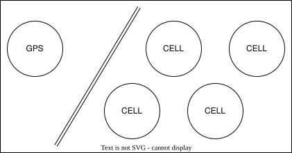

# Messflug

Messung mit der Drohne DJI Matrice 300 RTK. Die Messbox läuft im manuellen Modus: Sie verbindet sich und wartet, bis die Messung per Fernbefehl gestartet wird, und misst, bis sie per Fernbefehl gestoppt wird.

## Was man braucht

- die vorbereitete Messbox (siehe [Messbox vorbereiten](vorbereitung.md)), dort noch angeschlossen und im Backend unter `Fernkonfiguration` geöffnet
- `INIU Powerbank`, geladen, mit 4x M2x??-Schrauben [PRÜFEN! Länge]
- Adapterplatte (Messbox oben) oder Doppelhalterung (Messbox unten), siehe Abschnitt II
- M3x??-Schrauben und ggf. Unterlegscheiben, wiederverwendbare Kabelbinder
- USB-A-zu-USB-A- und USB-C-zu-USB-C-Kabel
- Absprache mit dem Fernpiloten über Gebiet, Raster und Geschwindigkeit

## Anleitung

### Abschnitt I – Worauf in der Konfiguration zu achten ist

#### Raster planen

Wie dicht die Messpunkte liegen, hängt vom Flugraster und vom Messintervall ab. Vor dem Flug mit dem Fernpiloten absprechen, welches Gebiet in welchem Bahnabstand und mit welcher Geschwindigkeit abgeflogen wird. Bei festem Bahnabstand und bekannter Geschwindigkeit ist die Messung nach Zeit (`time`) am einfachsten zu planen. Hintergrund unter [Messintervall und Rasterdichte](konfiguration.md#messintervall-und-rasterdichte).

Unten die bekannten Werte eintragen, der Rest wird soweit möglich berechnet. Berechnete Felder sind gestrichelt und fett. Ein berechnetes Feld lässt sich überschreiben, es zählt dann als bekannt.

Das Gebiet wird als Rechteck angenommen, das in parallelen Bahnen entlang der Länge abgeflogen wird (Mäander). Die Flugstrecke enthält die Querverbindungen zwischen den Bahnen, nicht aber Anflug, Kurven oder Steigen.

  <fieldset>
    <legend>Messung entlang der Bahn</legend>
    

      <label>Fluggeschwindigkeit [m/s]<input type="text" inputmode="decimal" data-var="v"></label>
      <label>Aufnahmeintervall [s]<input type="text" inputmode="decimal" data-var="t"></label>
      <label>Punktabstand entlang der Bahn [m]<input type="text" inputmode="decimal" data-var="d"></label>
    

  </fieldset>
  <fieldset>
    <legend>Raster und Gebiet</legend>
    

      <label>Bahnabstand [m]<input type="text" inputmode="decimal" data-var="b"></label>
      <label>Länge des Gebiets, entlang der Bahnen [m]<input type="text" inputmode="decimal" data-var="L"></label>
      <label>Breite des Gebiets, quer zu den Bahnen [m]<input type="text" inputmode="decimal" data-var="W"></label>
      <label class="fp-check"><input type="checkbox" data-square> Quadratisches Raster (Punktabstand = Bahnabstand)</label>
    

  </fieldset>
  <fieldset>
    <legend>Gesamter Flug</legend>
    

      <label>Flugstrecke [m]<input type="text" inputmode="decimal" data-var="S"></label>
      <label>Flugzeit [min]<input type="text" inputmode="decimal" data-var="T" data-scale="60"></label>
      <label>Anzahl Messpunkte<input type="text" inputmode="decimal" data-var="N"></label>
    

  </fieldset>
  
Geschwindigkeit: <strong data-out="kmh">–</strong> km/h · Bahnen: <strong data-out="tracks">–</strong>

  
Einstellung bei <code>time</code>: <code>Aufnahmeintervall</code> = <strong data-out="interval">–</strong> s · bei <code>distance</code>: <code>Positionsschwelle</code> = <strong data-out="threshold">–</strong> m

  

  <button type="button" data-reset>Alle Felder leeren</button>

Die Messpunkte zählen pro Aufnahme. Bei 5G NSA entstehen pro Aufnahme zwei Messpunkte (LTE und 5G), siehe [Was gemessen wird](messwerte.md#wie-ein-messpunkt-entsteht).

#### Einstellungen setzen

1. In der `Fernkonfiguration` folgende Einstellungen setzen:

    | Einstellung | Für den Messflug | Warum |
    |---|---|---|
    | `Missionsart` | `drone` | Kennzeichnet die Daten im Backend als Drohnenmessung. Auf den Ablauf der Messung hat sie keinen Einfluss. |
    | `Aufnahme-Auslöser` | `time` (empfohlen) oder `distance` | siehe [Raster planen](#raster-planen) |
    | `Aufnahmeintervall` bzw. `Positionsschwelle` | Wert aus dem Rechner | bestimmt den Abstand der Messpunkte |

2. Die Änderungen mit `Senden & Bestätigen` abschicken.
3. Im `Missionsstatus` den Fernbefehl `Manueller Modus` senden und dabei `Anschließend neu starten` anhaken. Im manuellen Modus wartet die Messbox nicht auf Bewegung und beendet die Messung nicht, wenn die Drohne in der Luft steht.
4. Warten, bis die Messbox wieder online ist. In der Spalte `Aktuell` prüfen, ob die neuen Werte angekommen sind. Auf dem Display steht nun `Idle (manual)`.
5. Per Fernbefehl `Herunterfahren`. Sobald das Display `SHUTTING DOWN` zeigt, die Stromversorgung trennen.

!!! warning "Nach dem Messflug zurückstellen"

    `Missionsart` und manueller Modus bleiben nach dem Flug so eingestellt. Vor der nächsten Messfahrt müssen sie zurückgestellt werden, siehe [Messfahrt](messfahrt.md#abschnitt-i-worauf-in-der-konfiguration-zu-achten-ist).

### Abschnitt II – Montage

Für die Montage an der Drohne gibt es zwei Möglichkeiten. Bei beiden wird zuerst die `INIU Powerbank` auf der Messbox festgeschraubt (4x M2x??-Schrauben).

=== "Messbox oben, Antenne unten"

    1. Den Adapter auf die Oberseite der Drohne montieren (vorne 2x M3x12 mm, ggf. mit Unterlegscheiben; hinten 2x M3x10 mm).
    2. Die Messbox mit den seitlichen Schrauben an der Adapterplatte befestigen (4x M3x?? mm [PRÜFEN!]).
    3. Die Antennenkabel durch den Adapter fädeln und die Antenne am Adapter befestigen.
    4. Antenne und Adapter an der Unterseite der Drohne befestigen (4x M3x?? mm [PRÜFEN!]).

=== "Messbox und Antenne unten"

    1. Wiederverwendbare Kabelbinder in die Laschen der Doppelhalterung fädeln.
    2. Die Antenne an der Doppelhalterung festmachen.
    3. Die Messbox an der Doppelhalterung festschrauben (4x M3x?? mm [PRÜFEN!]).
    4. Die Halterung an der Unterseite der Drohne montieren (M3x?? mm [PRÜFEN!] mit Unterlegscheiben).
    5. Die Halterung zusätzlich mit den Kabelbindern an den Standbeinen der Drohne festmachen.

!!! danger "Kabel weg von den Rotoren"

    Alle Kabel so verlegen, dass sie nicht in den Bereich der Rotoren gelangen können.

### Abschnitt III – Verkabeln und Einschalten

1. Die Antenne an der Messbox anschließen:  

2. Messbox und Powerbank mit dem USB-A-zu-USB-A-Kabel verbinden (Modem).
3. Messbox und Powerbank mit dem USB-C-zu-USB-C-Kabel verbinden. Der Raspberry Pi startet.
4. Nach etwa 10 s zeigt das Display den Zustand an.
5. Im Backend unter `Missionsstatus` prüfen, ob die Messbox online ist. Mit Push-Benachrichtigungen kommt `Messbox gestartet`.

### Abschnitt IV – Messung starten

1. Warten, bis das Display `Idle (manual)` zeigt.
2. Prüfen, ob die Messbox einen GPS-Fix bekommt. Im Leerlauf des manuellen Modus sucht sie von sich aus keine Position, das Display zeigt deshalb `GPS: no fix`. Unter `Testvisualisierung` den `GPS-Fix-Test starten`, siehe [Testvisualisierung](../../backend/testvisualisierung.md). Das Display zeigt dann `GPS: fix …`, sobald eine Position da ist.
    - Kommt kein Fix, braucht die Antenne freiere Sicht zum Himmel. Der Test zeigt live, ob eine andere Position besser ist.
3. Sobald die Drohne in Position ist, im `Missionsstatus` den Fernbefehl `Messung starten` senden. Er kommt mit dem nächsten Heartbeat an, also nicht sofort. Ein laufender GPS-Fix-Test wird dabei automatisch beendet.
4. Erst mit dem Raster beginnen, wenn das Display `Measuring` zeigt oder die Push-Benachrichtigung `Messung gestartet` kommt.

!!! info "Ohne GPS-Fix starten"

    Nach `Messung starten` wartet die Messbox zuerst auf eine Position. Display und Backend zeigen in dieser Zeit `No GPS fix` bzw. `Warten auf GPS-Fix`. Das Warten hat keine Zeitgrenze: Die Messbox beginnt zu messen, sobald ein Fix da ist. Mit `Messung stoppen` lässt sich der Start abbrechen, die Messbox kehrt dann in den Leerlauf zurück.

### Abschnitt V – Während des Flugs

- Auf dem Display bzw. im `Missionsstatus` sollte `Valid` mit `Tot` steigen. `Inv` größer als 0 ist möglich.
- Steht `PIPELINE BROKEN` auf dem Display oder kommt die Push-Benachrichtigung `Fehler`, siehe [Troubleshooting](../troubleshooting/fehlerbilder.md).
- Die Messbox kann sich nach einem Fehler selbst neu starten, siehe [Automatischer Neustart](../troubleshooting/fehlerbilder.md#automatischer-neustart-und-critical-error). Danach wartet sie im manuellen Modus wieder auf `Messung starten`. Nach wiederholten Fehlern zeigt sie stattdessen `Idle (recovery)` und wartet ebenfalls auf `Messung starten`.

### Abschnitt VI – Messung beenden

1. Wenn das Raster abgeflogen ist, im `Missionsstatus` den Fernbefehl `Messung stoppen` senden.
2. Die Messbox schließt die Daten ab (`Finalizing`), lädt sie hoch und fährt herunter (`SHUTTING DOWN`). Mit Push-Benachrichtigungen kommen `Messung beendet` und `Neue Läufe hochgeladen`.
    - Alternativ die Messbox per `Herunterfahren` beenden oder nach der Landung die Stromversorgung trennen. Die Daten bleiben dann auf der Messbox und werden bei einem späteren Lauf hochgeladen.

!!! tip "Weiter"

    Weiter zu [Nach dem Einsatz](abschluss.md).
