# Wie die Messbox misst

Diese Seite erklärt, wie die Messbox eine Messung durchführt: in welchem Modus sie startet, welche Phasen sie durchläuft, was das Display anzeigt und wann Daten hochgeladen werden. Die Bedienung Schritt für Schritt steht in der Anleitung ab [Nutzung](index.md).

## Betriebsmodi

Die Messbox startet in einem von zwei Modi. In beiden baut sie gleich nach dem Einschalten die Mobilfunkverbindung auf und meldet sich beim Backend, sie ist also schon vor dem Messstart dort sichtbar.

### Automatikmodus

Das ist der Standard. Die Messbox wartet auf einen GPS-Fix und dann auf Bewegung. Sobald sich das Fahrzeug bewegt, startet die Messung von selbst. Es ist keine Bedienung nötig. Steht das Fahrzeug länger als die `Leerlaufschwelle` (Standard 1800 s), endet die Messung von selbst.

### Manueller Modus

Die Messbox verbindet sich, startet aber **nicht von selbst**. Sie wartet, bis die Messung per Fernbefehl `Messung starten` im Backend freigegeben wird. Auf dem Display steht `Idle (manual)`.

Der manuelle Modus ist vor allem für Messungen aus der Luft und für die Fehlersuche gedacht. Die Messbox achtet hier nicht auf Bewegung: Nach `Messung starten` wartet sie nur noch auf einen GPS-Fix und misst dann sofort. Im Leerlauf lassen sich außerdem der Selbsttest und der GPS-Fix-Test starten.

Im manuellen Modus endet eine Messung **nie von selbst**, auch nicht bei Stillstand. Sie läuft, bis sie per `Messung stoppen` beendet, die Messbox heruntergefahren oder der Strom getrennt wird.

!!! note "Einmal manuell nach `Messung stoppen`"

    Wird eine Messung im Automatikmodus per `Messung stoppen` beendet, startet die Messbox beim nächsten Hochfahren **einmalig** im manuellen Modus. Danach gilt wieder der eingestellte Modus. Details unter [Fernbefehle](fernbefehle.md#messung-stoppen).

!!! note "Nach wiederholten Fehlern"

    Tritt beim Betrieb mehrmals hintereinander derselbe Fehler auf, startet die Messbox einmalig in einen Wiederherstellungszustand (`Idle (recovery)`). Wie im manuellen Modus misst sie dann erst nach `Messung starten`. Der nächste Start ist wieder normal. Siehe [Fehlerbilder](../troubleshooting/fehlerbilder.md#automatischer-neustart-und-critical-error).

!!! tip "Modus wechseln"
    Der Modus (`Automatikmodus` oder `Manueller Modus`) lässt sich im Backend per gleichnamigem Fernbefehl umstellen. Die Umstellung gilt **erst nach dem nächsten Start** der Messbox, nicht sofort. Siehe [Fernbefehle](fernbefehle.md#modus-wechseln).

## Phasen eines Durchlaufs

Ein Durchlauf (vom Einschalten bis zum Herunterfahren) besteht aus festen Phasen, die auf dem Display und im `Missionsstatus` im Backend angezeigt werden:

1. Starten (`Starting up`): Konfiguration laden, Mobilfunkverbindung aufbauen.
2. Daten eines früheren Laufs sichern (`Recovering data`), falls welche übrig sind.
3. Im Automatikmodus auf GPS-Fix warten (`No GPS fix`) und dann auf Bewegung (`Waiting: move`). Kommt innerhalb der `Max. Wartezeit auf ersten GPS-Fix` (Standard 300 s) kein Fix, endet der Durchlauf ohne Messung.
4. Im manuellen Modus stattdessen auf den Fernbefehl `Messung starten` warten (`Idle (manual)`), danach auf einen GPS-Fix (`No GPS fix`). Dieses Warten hat keine Zeitgrenze.
5. Messen (`Measuring`).
6. Abschließen und hochladen (`Finalizing`), danach `Done` und Herunterfahren.

Was die Zeilen des Displays im Einzelnen bedeuten, steht unter [Statusanzeige](#statusanzeige). Das folgende Zustandsdiagramm zeigt die Zustände während eines Laufs und ihre Übergänge. Transitionen mit `RC:...` als Trigger beschreiben die Auswirkungen bestimmter Fernkommandos auf den Zustand des Systems. Wie dem Diagramm zu entnehmen ist enthalten viele der Zustände jeweils nochmal intrinsische Abläufe, die jedoch abseits von detailliertem Debugging nicht relevant sein sollten und daher in diesem Diagramm nicht angezeigt werden. Sie sind jedoch unter dem Diagramm zu finden.

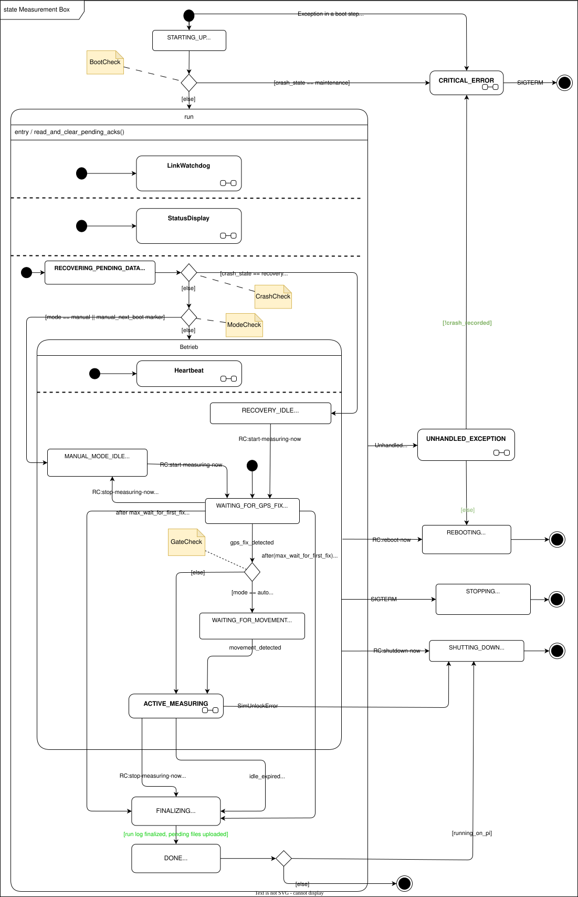

??? note "Abläufe innerhalb der Zustände"

    **Startup**

    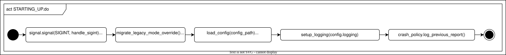

    **Daten eines früheren Laufs sichern (`Recovering data`)**

    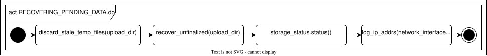

    **Auf GPS-Fix warten (`No GPS fix`)**

    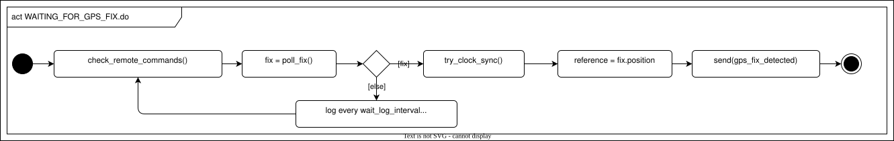

    **Auf Bewegung warten (`Waiting: move`)**

    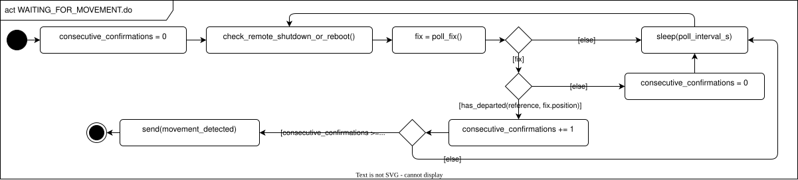

    **Messen (`Measuring`)**

    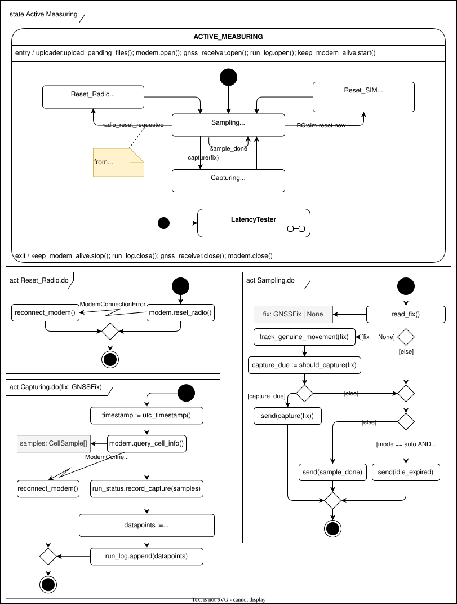

    **Latenzmessung (`LatencyTester`, parallel zum Messen)**

    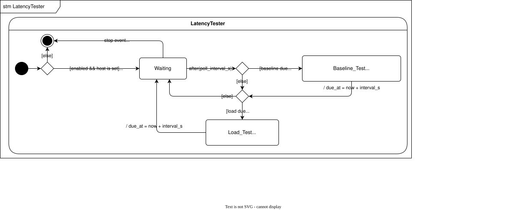

    **Abschließen und hochladen (`Finalizing`)**

    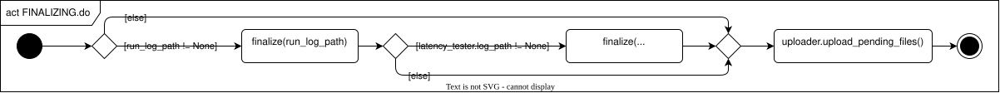

    **Herunterfahren (`SHUTTING DOWN`)**

    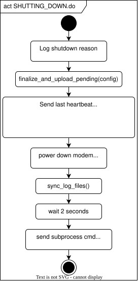

    **Kritischer Fehler (`CRITICAL ERROR`)**

    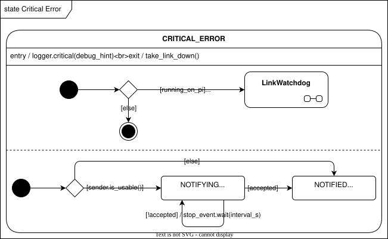

    **Unbehandelter Fehler (`UNHANDLED EXCEPTION`)**

    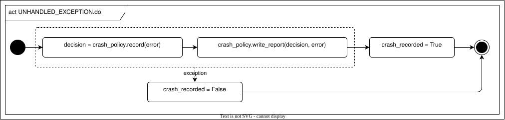

??? note "Hintergrundprozesse während des Laufs"

    Diese Prozesse laufen parallel zum Zustandsdiagramm oben und sind im Hauptdiagramm als eigene, eingeklappte Regionen dargestellt.

    **Verbindungsüberwachung (`LinkWatchdog`)**

    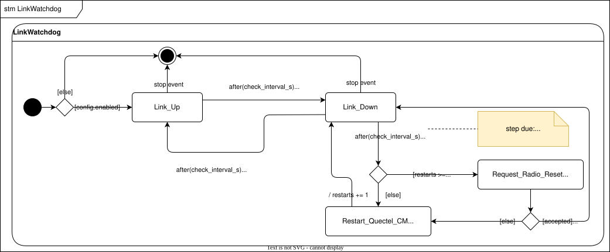

    **Statusanzeige (`StatusDisplay`)**

    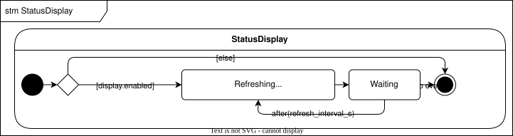

    **Heartbeat zum Backend (`Heartbeat`)**

    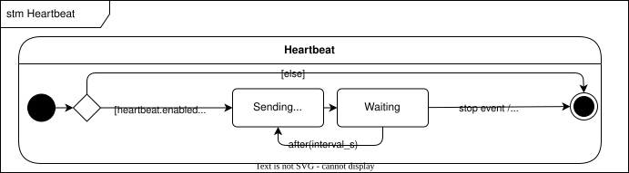

    **Heartbeat senden (`Sending.do`)**

    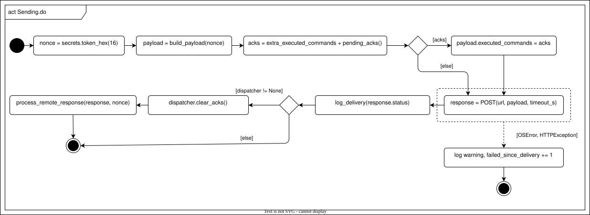

    **Antwort des Backends verarbeiten (`process_remote_response`)**

    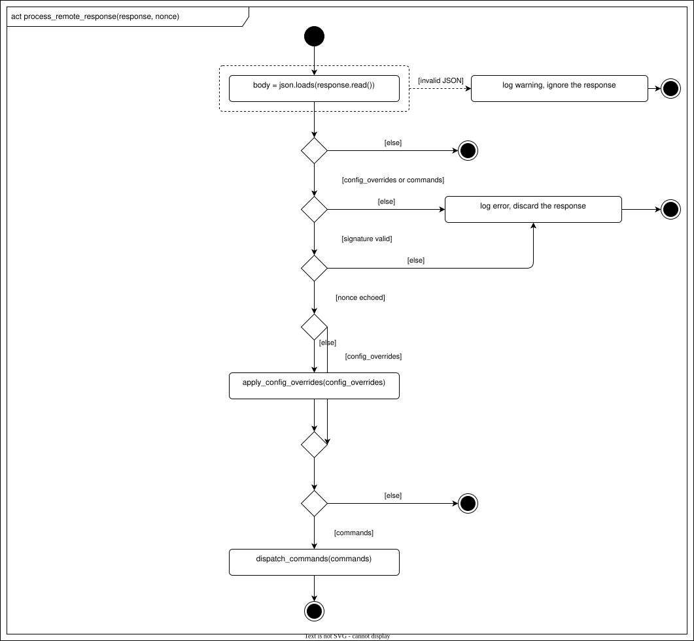

    **Einzelnen Fernbefehl ausführen (`dispatch_one`)**

    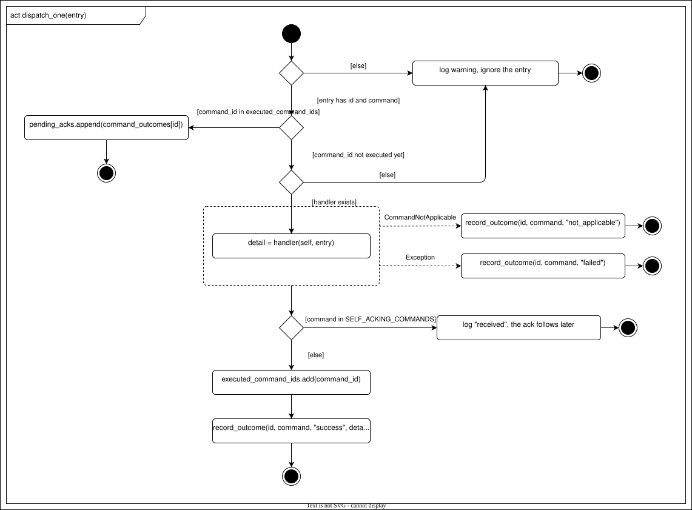

## Statusanzeige

Das OLED-Display (128×64 px) zeigt bis zu 6 Zeilen, alle 2 s aktualisiert:

| Zeile | Inhalt |
|---|---|
| 1 | Zustand (Tabelle unten) |
| optional | `PIPELINE BROKEN`: Messungen kommen trotz Bewegung leer zurück (3 leere Messungen in Folge) |
| 2 | `GPS: no fix` bzw. `GPS: fix <n>sat <s>s` |
| optional | GPS-Diagnose, z. B. Antennenfehler |
| 3 | `Valid <n> Inv <n> Tot <n>`: gültige, ungültige, gesamte Messpunkte |
| optional | Hinweis auf Testmodus, z. B. `GPS disabled` |

Die Messbox kann sich in verschiedenen Zuständen befinden. Das [Zustandsdiagramm](#phasen-eines-durchlaufs) zeigt, wie die Zustände zusammenhängen. Diese werden sowohl auf dem Display, als auch im Missionsstatus im Backend angezeigt.

??? note "Zustände und ihre Bedeutung"

    | Anzeige | Bedeutung |
    |---|---|
    | `Recovering data` | Daten eines früheren Laufs werden gesichert |
    | `No GPS fix` | Wartet auf GPS-Fix, freie Sicht zum Himmel nötig |
    | `Waiting: move` | Fix vorhanden, wartet auf Bewegung |
    | `Starting up` | Die Software startet |
    | `Idle (manual)` | [Manueller Modus](#manueller-modus), Start nur per [Fernbefehl](fernbefehle.md#ubersicht) („Messung starten“) |
    | `Idle (recovery)` | Wiederherstellung nach wiederholten Fehlern, Start nur per Fernbefehl, siehe [Fehlerbilder](../troubleshooting/fehlerbilder.md#automatischer-neustart-und-critical-error) |
    | `Measuring` | Messung läuft |
    | `Finalizing` | Daten werden abgeschlossen und hochgeladen |
    | `Done` | Lauf beendet |
    | `STOPPING` | Die Software wird von außen beendet, z. B. per SSH zur Wartung oder beim Herunterfahren des Betriebssystems. Die Messdaten werden vorher abgeschlossen und nach Möglichkeit hochgeladen |
    | `SHUTTING DOWN` | Gerät fährt herunter |
    | `REBOOTING` | Neustart |
    | `CRITICAL ERROR` | Schwerer Fehler (Wartungsmodus). Steht nur im Backend, das Display wird dann nicht mehr angesteuert. Siehe [Troubleshooting](../troubleshooting/fehlerbilder.md#automatischer-neustart-und-critical-error) |

## Messfahrt und Messflug im Vergleich

| | Messfahrt | Messflug |
|---|---|---|
| Modus | Automatikmodus | Manueller Modus |
| `Missionsart` | `ground` | `drone` (nur zur Kennzeichnung der Daten) |
| Start | von selbst, etwa anderthalb Minuten nach der Abfahrt | per Fernbefehl `Messung starten`, sobald ein GPS-Fix da ist |
| Messpunkte | alle 15 m (`distance`) | nach Flugraster, meist `time` |
| Ende | von selbst nach 1800 s Stillstand | per Fernbefehl `Messung stoppen` |
| Anleitung | [Messfahrt](messfahrt.md) | [Messflug](messflug.md) |

Alle Werte sind Standardwerte und lassen sich über die [Konfiguration](konfiguration.md) anpassen.

## Daten hochladen und prüfen

- Die Messbox lädt Messdaten hoch, wenn die Messung beginnt und wenn sie abgeschlossen ist. Eine Datei wird erst nach erfolgreichem Upload auf dem Gerät gelöscht.
- Bricht ein Lauf ab, z. B. weil der Strom wegfällt, schließt die Messbox die übrigen Daten beim nächsten Start ab (`Recovering data`). Hochgeladen werden sie danach, sobald die nächste Messung beginnt oder der Durchlauf endet, beim Herunterfahren oder Neustart oder sofort per Fernbefehl `Upload erzwingen`.
- Sind [Push-Benachrichtigungen](../../backend/einstellungen.md#push-benachrichtigungen) eingerichtet, meldet `Neue Läufe hochgeladen`, dass Messdaten im Backend angekommen sind. `Messung gestartet` und `Messung beendet` zeigen, wann eine Messbox in `Messung läuft` wechselt bzw. diesen Zustand verlässt.
- Nach dem Einsatz kann im Backend unter `Messläufe` geprüft werden, ob die Daten angekommen sind, siehe [Messläufe und Kampagnen](../../backend/messlaeufe.md#prufen-ob-die-daten-angekommen-sind).
