# How the unit measures

This page explains how the unit performs a measurement: which mode it starts in, which phases it goes through, what the display shows and when data is uploaded. The step-by-step operation is described in the guide starting at [Usage](index.md).

## Operating modes

The unit boots into one of two modes. In both, it brings up the cellular link right after switch-on and reports to the backend, so it is visible there before measuring starts.

### Auto Mode

This is the default. The unit waits for a GPS fix and then for movement. As soon as the vehicle moves, measuring starts by itself. No operation is needed. If the vehicle stands for longer than the `Idle threshold` (default 1800 s), the measurement ends by itself.

### Manual Mode

The unit connects but does **not start by itself**. It waits until the measurement is released with the remote command `Start measuring` in the backend. The display shows `Idle (manual)`.

Manual Mode is mainly intended for airborne measurements and troubleshooting. The unit does not watch for movement here: after `Start measuring` it only waits for a GPS fix and then measures immediately. While idle, the self-test and the GPS fix test can also be started.

In Manual Mode a measurement **never ends by itself**, not even at standstill. It runs until it is ended with `Stop measuring`, the unit is shut down or the power is disconnected.

!!! note "Once manual after `Stop measuring`"

    If a measurement in Auto Mode is ended with `Stop measuring`, the unit boots **once** into Manual Mode the next time it starts. After that the configured mode applies again. Details under [Remote commands](remote-commands.md#stop-measuring).

!!! note "After repeated errors"

    If the same error occurs several times in a row during operation, the unit boots once into a recovery state (`Idle (recovery)`). As in Manual Mode, it then only measures after `Start measuring`. The next start is normal again. See [Known failure modes](../troubleshooting/failure-modes.md#automatic-reboot-and-critical-error).

!!! tip "Switching the mode"
    The mode (`Auto Mode` or `Manual Mode`) can be switched in the backend with the remote command of the same name (`Auto mode` / `Manual mode`). The switch only takes effect **after the next start** of the unit, not immediately. See [Remote commands](remote-commands.md#switching-the-mode).

## Phases of a pass

A pass (from switch-on to shutdown) consists of fixed phases, which are shown on the display and in `Mission Status` in the backend:

1. Starting (`Starting up`): load the configuration, bring up the cellular link.
2. Save the data of an earlier run (`Recovering data`), if any is left.
3. In Auto Mode, wait for a GPS fix (`No GPS fix`) and then for movement (`Waiting: move`). If no fix arrives within the `Max wait for first GPS fix` (default 300 s), the pass ends without measuring.
4. In Manual Mode, instead wait for the remote command `Start measuring` (`Idle (manual)`), then for a GPS fix (`No GPS fix`). This wait has no time limit.
5. Measure (`Measuring`).
6. Finalize and upload (`Finalizing`), then `Done` and shutdown.

What the lines of the display mean in detail is described under [Status display](#status-display). The following state diagram shows the states during a run and their transitions. Transitions with `RC:...` as trigger describe the effects of certain remote commands on the state of the system. As the diagram shows, many of the states contain intrinsic sequences of their own, which should not be relevant apart from detailed debugging and are therefore not shown in this diagram. They can be found below the diagram.

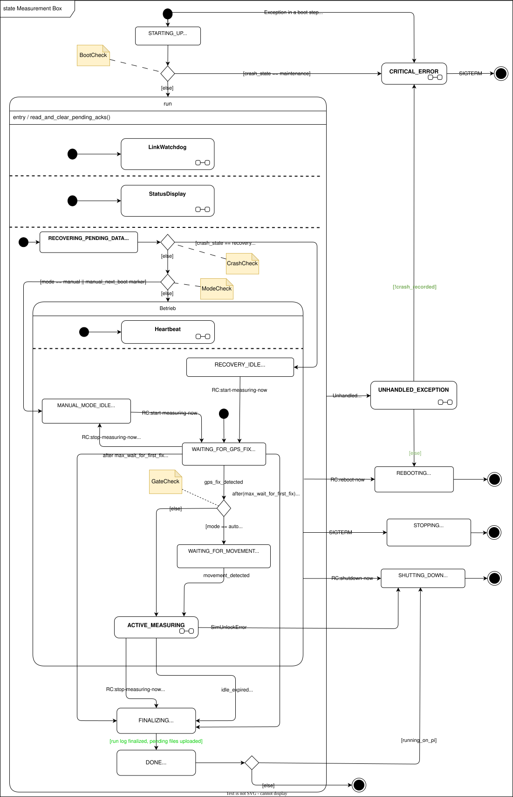

??? note "Sequences within the states"

    **Startup**

    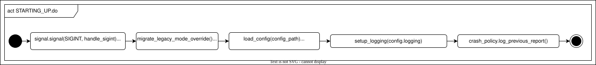

    **Saving the data of an earlier run (`Recovering data`)**

    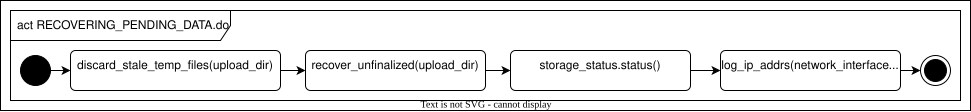

    **Waiting for a GPS fix (`No GPS fix`)**

    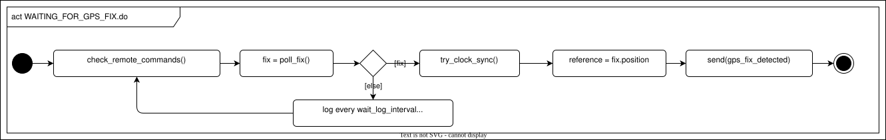

    **Waiting for movement (`Waiting: move`)**

    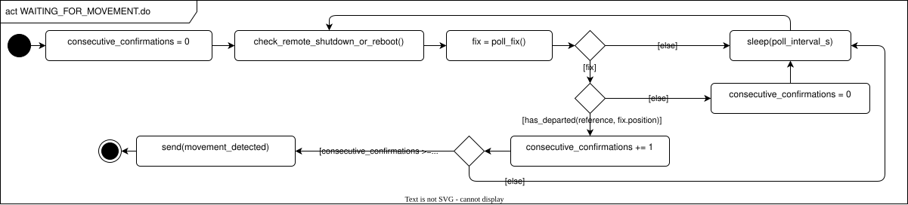

    **Measuring (`Measuring`)**

    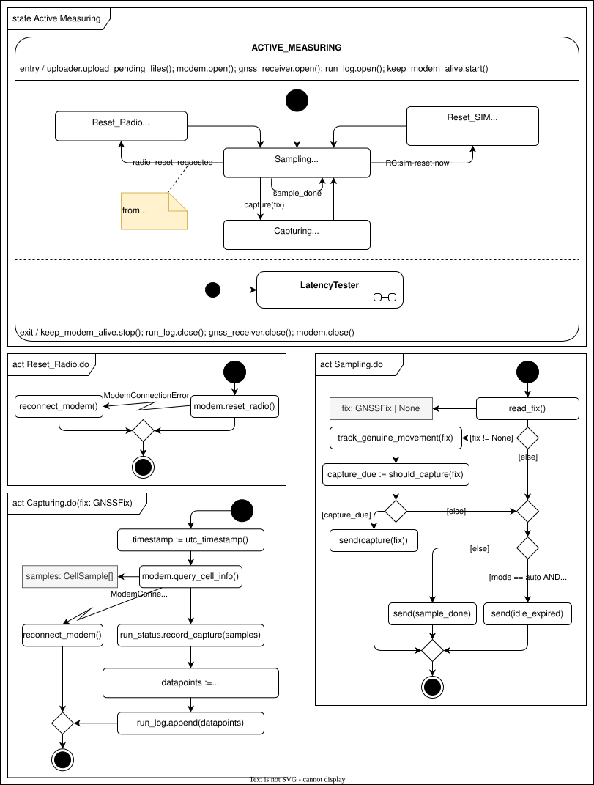

    **Latency measurement (`LatencyTester`, parallel to measuring)**

    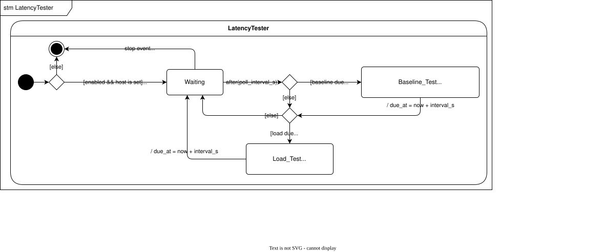

    **Finalizing and uploading (`Finalizing`)**

    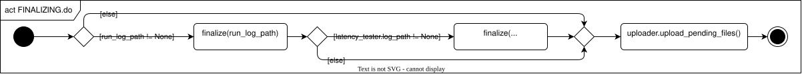

    **Shutting down (`SHUTTING DOWN`)**

    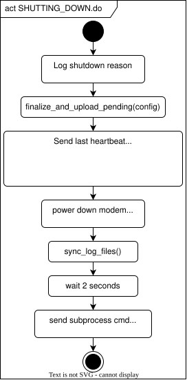

    **Critical error (`CRITICAL ERROR`)**

    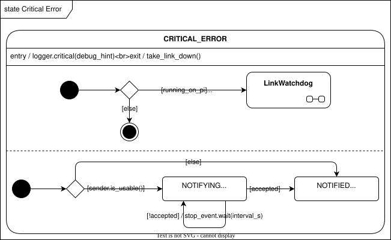

    **Unhandled error (`UNHANDLED EXCEPTION`)**

    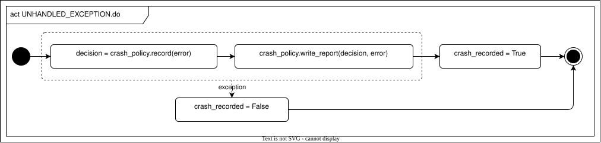

??? note "Background processes during the run"

    These processes run in parallel to the state diagram above and are shown in the main diagram as separate, collapsed regions.

    **Connection monitoring (`LinkWatchdog`)**

    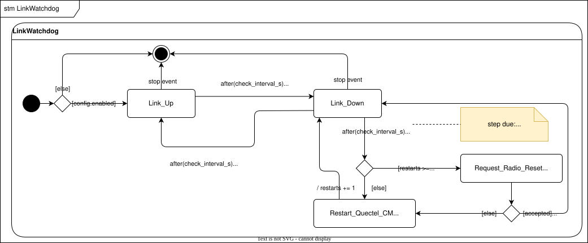

    **Status display (`StatusDisplay`)**

    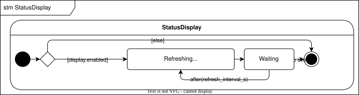

    **Heartbeat to the backend (`Heartbeat`)**

    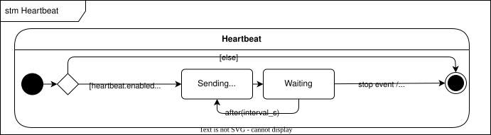

    **Sending a heartbeat (`Sending.do`)**

    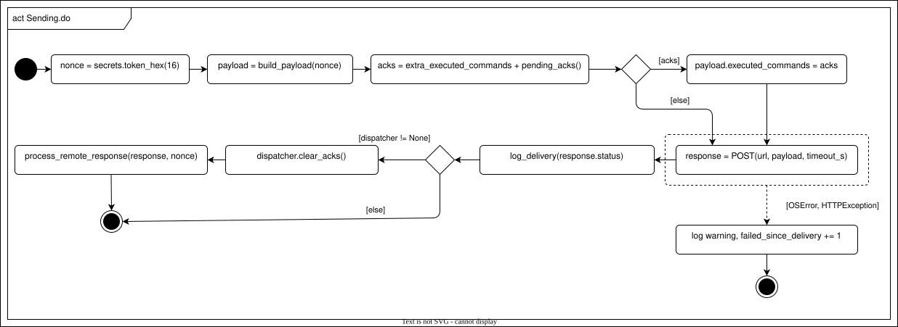

    **Processing the backend's response (`process_remote_response`)**

    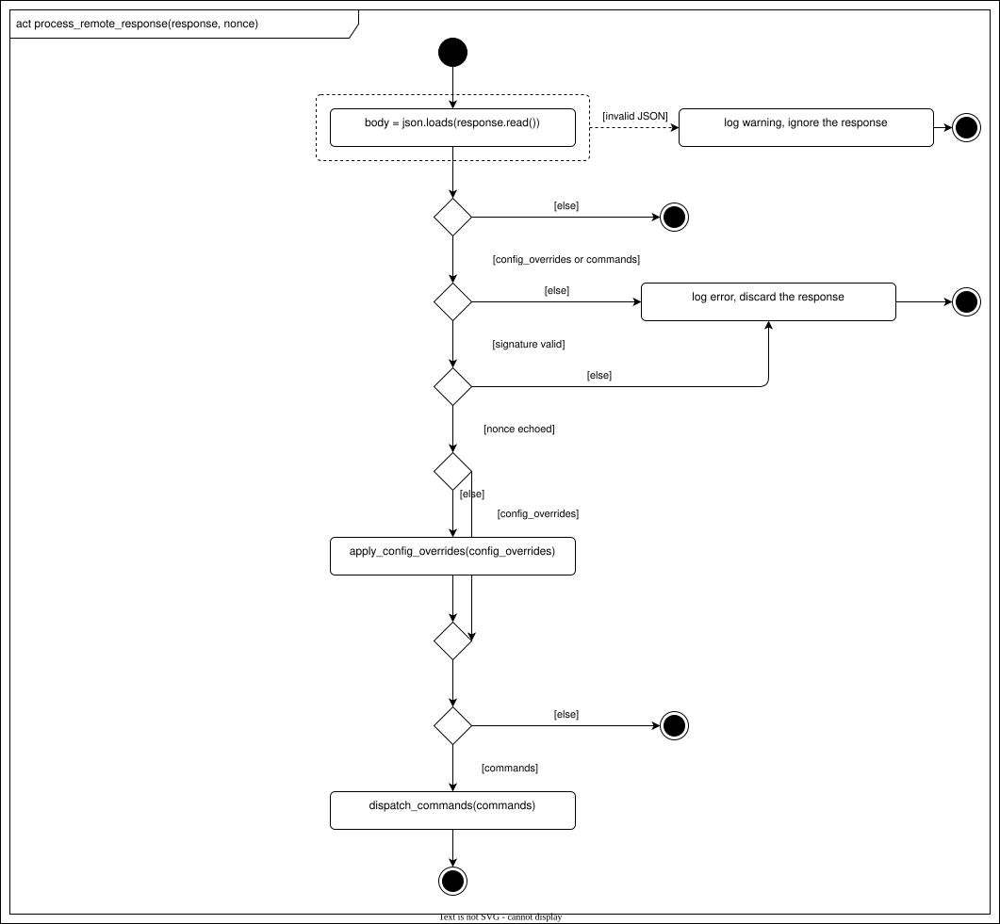

    **Executing a single remote command (`dispatch_one`)**

    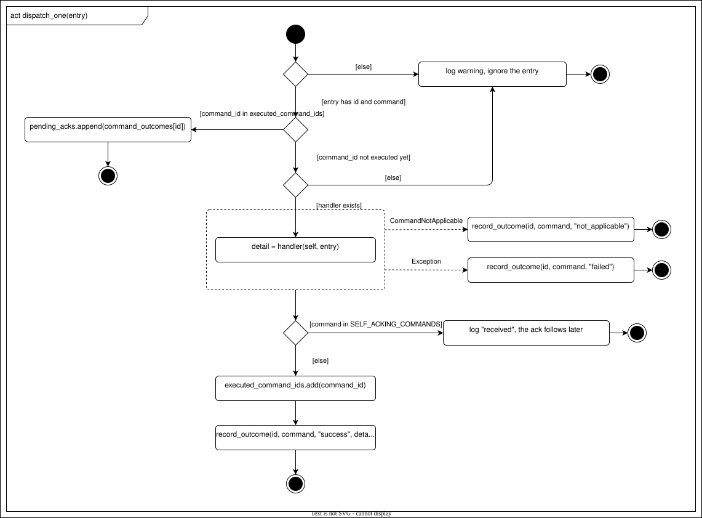

## Status display

The OLED display (128×64 px) shows up to 6 lines, refreshed every 2 s:

| Line | Content |
|---|---|
| 1 | State (table below) |
| optional | `PIPELINE BROKEN`: measurements come back empty despite movement (3 empty measurements in a row) |
| 2 | `GPS: no fix` or `GPS: fix <n>sat <s>s` |
| optional | GPS diagnostics, e.g. antenna fault |
| 3 | `Valid <n> Inv <n> Tot <n>`: valid, invalid and total datapoints |
| optional | Note on test mode, e.g. `GPS disabled` |

The unit can be in different states. The [state diagram](#phases-of-a-pass) shows how the states are connected. They are shown both on the display and in Mission Status in the backend.

??? note "States and their meaning"

    | Display | Meaning |
    |---|---|
    | `Recovering data` | Data of an earlier run is being saved |
    | `No GPS fix` | Waiting for a GPS fix, clear view of the sky needed |
    | `Waiting: move` | Fix available, waiting for movement |
    | `Starting up` | The software is starting |
    | `Idle (manual)` | [Manual Mode](#manual-mode), start only by [remote command](remote-commands.md#overview) (`Start measuring`) |
    | `Idle (recovery)` | Recovery after repeated errors, start only by remote command, see [Known failure modes](../troubleshooting/failure-modes.md#automatic-reboot-and-critical-error) |
    | `Measuring` | Measurement running |
    | `Finalizing` | Data is being finalized and uploaded |
    | `Done` | Run ended |
    | `STOPPING` | The software is being terminated from outside, e.g. via SSH for maintenance or when the operating system shuts down. The measurement data is finalized beforehand and uploaded if possible |
    | `SHUTTING DOWN` | Device is shutting down |
    | `REBOOTING` | Rebooting |
    | `CRITICAL ERROR` | Severe error (maintenance mode). Only shown in the backend; the display is no longer driven. See [Troubleshooting](../troubleshooting/failure-modes.md#automatic-reboot-and-critical-error) |

## Measurement drive and measurement flight compared

| | Measurement drive | Measurement flight |
|---|---|---|
| Mode | Auto Mode | Manual Mode |
| `Mission type` | `ground` | `drone` (only to mark the data) |
| Start | by itself, about a minute and a half after departure | by remote command `Start measuring`, once a GPS fix is available |
| Datapoints | every 15 m (`distance`) | per flight grid, usually `time` |
| End | by itself after 1800 s of standstill | by remote command `Stop measuring` |
| Guide | [Measurement drive](measurement-drive.md) | [Measurement flight](measurement-flight.md) |

All values are defaults and can be adjusted via the [Configuration](configuration.md).

## Uploading and checking data

- The unit uploads measurement data when the measurement begins and when it is finalized. A file is only deleted on the device after a successful upload.
- If a run is interrupted, e.g. because the power fails, the unit finalizes the remaining data at the next start (`Recovering data`). It is then uploaded as soon as the next measurement begins or the pass ends, on shutdown or reboot, or immediately by the remote command `Force upload`.
- If [push notifications](../../backend/settings.md#push-notifications) are set up, `New runs uploaded` reports that measurement data has arrived in the backend. `Measurement started` and `Measurement finished` show when a unit switches into `Measuring` or leaves this state.
- After the deployment, you can check in the backend under `Measurement Runs` whether the data has arrived, see [Runs and campaigns](../../backend/runs.md#checking-that-the-data-has-arrived).
